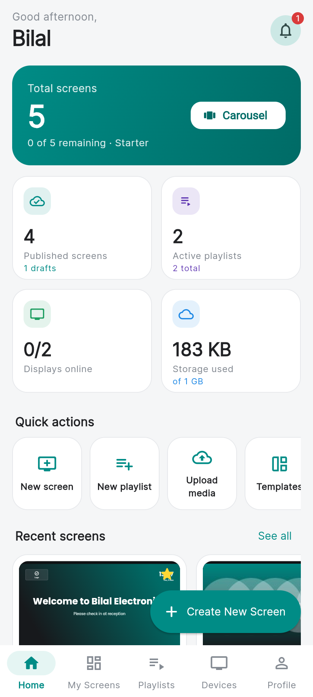

# Signal Signage: Mobile-First Digital Signage Platform

Signal Signage is a complete digital-signage system:

* Business owners design screens on their phone, combine them into playlists and schedule them.
* Android TV players show the content, keep playing when offline, and update automatically.
* A super admin controls users, plans, limits and devices.

| Part | Technology | Location |
|---|---|---|
| REST API (111 endpoints) | Procedural PHP 8.1+ with MySQLi prepared statements, JSON | `backend/` |
| Database (39 tables, 2 views) | MySQL 8 / MariaDB, InnoDB, utf8mb4 | `backend/database/` |
| Management app (users + super admin) | Flutter 3, Material 3, Riverpod, go_router, Dio | `flutter_app/lib/main.dart` |
| TV display | **The same app**: tap *Show Display* on the sign-in page and enter a screen or playlist code | `flutter_app/lib/features/display/` |



## Status

| Check | Result |
|---|---|
| Database suite | **57/57** checks pass |
| End-to-end API suite (workflows A–E, display codes, limits, IDOR, uploads, pairing, sync, rate limits) | **246/246** checks pass |
| Flutter tests (incl. screen-card overflow at 144–230 px widths and 130% font size) | **24/24** pass |
| `flutter analyze` | No issues |
| Web build of both apps | Done |
| Live player test (register → pair → sync → play → command → emergency) | Done |

Full details and the list of things that were **not** tested in this environment (native Android/iOS builds, MySQL 8, real devices) are in **[docs/TESTING.md](docs/TESTING.md)**.

## Screens

| Area | Screenshots |
|---|---|
| Management app (412×915) | `docs/screenshots/01_login.png` … `22_admin_plans.png`: dashboard, My Screens, template library, editor (select, drag, settings, layers, add widget), playlists, playlist builder, schedules, devices, device detail, media library, profile, admin dashboard, users, create user, plans |
| TV player (1920×1080) | `23_player_pairing.png`, `24`–`26_player_playing_*.png` (automatic rotation), `27_player_emergency.png` |

## Features

**User app**
* Dashboard with plan usage and quick actions.
* Screens: create from **26 templates in 14 categories** or a blank canvas (landscape, portrait, square or custom size). Also folders, search, filters, favourites, duplicate and save-as-template.
* Visual editor:
  * drag, resize handles, snapping guides, zoom
  * layers, lock, front/back, align, multi-select
  * copy/paste, undo/redo, autosave with conflict detection
  * preview, publish
* Widgets: **31 renderable types**, each with a settings panel generated from its configuration:
  * media: image, carousel, video, logo, background image, shape
  * text: heading, rich text, ticker
  * time: digital and analog clock, world clock, countdown, count-up, calendar, daily schedule
  * data: weather (Open-Meteo), RSS, live JSON data, QR code
  * business: menu board, price list, product showcase, contact, opening hours, location
  * messages: announcements, quotes, daily motivation, emergency
  * embeds: web page and custom HTML (WebView on Android/iOS)
* Backgrounds: colour, gradient, image, video or preset, with opacity, blur, overlay, fit and position.
* Media library: uploads with progress, folders, rename, move, delete with in-use protection, storage meter.
* Playlists ("screen carousels"): pick screens, drag to reorder, set durations, 8 transitions, loop, shuffle, priority, preview, publish, assign to displays.
* Scheduling: time slots, days, date ranges, overnight slots, time zones, priorities and special events, plus a day timeline.
* Devices: pair with a 6-character code, assign playlists and a default, remote restart/pause/resume/sync/identify/clear cache, logs, live status, locations, emergency broadcast, reports.

**Super admin**
* Dashboard (users, screens, playlists, devices, storage, offline list, activity).
* Users: create with a generated password and share sheet, edit, reset password, suspend, delete. Per-user limits (`∞` / number / follow the plan) and permission overrides.
* Plans: Free, Starter, Professional, Business and Enterprise, all editable.
* Content overview, widget availability, all devices, media (shared library), audit log, app settings.

**Show on a TV: one app, just a code**
* Every screen and playlist has a display code (shown under ⋮ → *Show on a TV* and the 📺 button on each card). Users can choose their own code (for example `LOBBY`) or generate a new one.
* On the TV, install the same app → *Show Display* on the sign-in page → type the code → it plays full screen.
* Updates within a minute of publishing. Keeps playing from its cache when offline, and reopens straight into display mode after a reboot.
* OK, Enter or Back on the remote (or a long press) opens a menu: continue, check for updates, change code, exit.
* Emergency broadcasts sent to "all displays" also appear on code displays.

**Managed displays (optional, same app)**
* Registration and pairing screen with code and QR.
* Version-based sync with **SHA-256-verified** media cache. A new version goes live only when all its media is ready.
* Offline playback from the persisted cache.
* Schedule engine identical to the server's (unit tested).
* Transitions, heartbeats, command queue, proof-of-play and logs queued offline.
* Emergency override, idle clock screen, info panel on the remote's OK button, boot auto-start, wakelock.

**Security**
* bcrypt passwords. Tokens, reset codes and pairing codes are stored only as SHA-256 hashes.
* Role and permission checks on the server, ownership checks on every query, plus composite foreign keys that prevent cross-tenant links.
* Rate limits, MIME-sniffed uploads, signed expiring media URLs, generic error messages, audit log.

## Quick start

See **[docs/DEPLOYMENT.md](docs/DEPLOYMENT.md)** for full and production instructions.

1. Create the database:

   ```bash
   mysql -u root -p -e "CREATE DATABASE signage CHARACTER SET utf8mb4 COLLATE utf8mb4_unicode_ci"
   ```

2. Load the schema:

   ```bash
   mysql -u root -p signage < backend/database/schema.sql
   ```

3. Load the seed data:

   ```bash
   mysql -u root -p signage < backend/database/seed.sql
   ```

4. Start the API:

   ```bash
   DB_NAME=signage DB_USER=root DB_PASS=secret php -S 0.0.0.0:8080 -t backend backend/router.php
   ```

5. Run the management app (from `flutter_app/`):

   ```bash
   flutter run --flavor manager -t lib/main.dart --dart-define=API_BASE_URL=http://10.0.2.2:8080
   ```

6. On a TV (or a second emulator), run the same app, tap **Show Display** and enter a code. The demo data includes `STORE1` and `EVENING` (playlists) and `WELCOME` and `PROMO1` (screens).

Development logins (delete them before production):

| Role | Email | Password |
|---|---|---|
| Super admin | admin@signage.local | Admin@12345 |
| User A (2 screens, at limit) | aisha@demo.local | Demo@12345 |
| User B (full demo data) | bilal@demo.local | Demo@12345 |
| User C (10 screens) | chloe@demo.local | Demo@12345 |
| User D (unlimited) | daniel@demo.local | Demo@12345 |

## Documentation

| File | Contents |
|---|---|
| [docs/ARCHITECTURE.md](docs/ARCHITECTURE.md) | System design, auth, data flows, schedule priority, sync and offline, the layout JSON contract, widget system, security |
| [docs/ER_DIAGRAM.md](docs/ER_DIAGRAM.md) | Mermaid ER diagram and relationships |
| [docs/DATABASE.md](docs/DATABASE.md) | Every table and column, limit rules, cross-user protection, publication format, seed data |
| [docs/API.md](docs/API.md) | All 111 endpoints with request and response formats |
| [docs/DEPLOYMENT.md](docs/DEPLOYMENT.md) | Local setup, Apache/Nginx, cron, hardening, building and signing the apps, installing on TVs |
| [docs/TESTING.md](docs/TESTING.md) | Test results and coverage, and what still needs on-device testing |

## Known limitations

* **Widgets not yet available.** PDF viewer, PowerPoint, YouTube, social feeds and the battery indicator are registered but marked *planned* and hidden from users. They need the extra integrations described in the architecture before they can be enabled.
* **Web-only widget behaviour.** The web page and custom HTML widgets play only on Android/iOS players (WebView); the management web app shows a placeholder for them. RSS feeds may be blocked by CORS in the web build, but they work on the player.
* **Email.** Password-reset and credential emails use PHP `mail()` when `MAIL_ENABLED=1`, and are otherwise written to `backend/logs/mail.log`. Configure an SMTP relay for production.
* **Media storage.** Media is stored on local disk. The schema already supports S3 (`storage_driver`), but there is no S3 adapter yet.
