# Entity–Relationship Diagram

GitHub, GitLab and most Markdown viewers render this Mermaid diagram directly. Only the key columns are shown; `DATABASE.md` lists every column.

```mermaid
erDiagram
    roles ||--o{ users : "has"
    roles ||--o{ role_permissions : ""
    permissions ||--o{ role_permissions : ""
    users ||--o{ user_permissions : "overrides"
    permissions ||--o{ user_permissions : ""
    users ||--o{ user_settings : ""
    users ||--o{ user_subscriptions : ""
    plans ||--o{ user_subscriptions : ""
    users ||--o| user_limits : "overrides plan"
    users ||--o{ api_tokens : ""
    users ||--o{ password_resets : ""

    template_categories ||--o{ screen_templates : ""
    screen_templates ||--o{ template_favorites : ""
    users ||--o{ template_favorites : ""
    widget_types ||--o{ screen_widgets : "widget_type = widget_key"
    widget_types ||--o{ user_recent_widgets : ""

    users ||--o{ media_folders : ""
    media_folders ||--o{ media_folders : "parent"
    media_folders ||--o{ media_library : ""
    users ||--o{ media_library : "owns"

    users ||--o{ screen_folders : ""
    screen_folders ||--o{ screens : ""
    users ||--o{ screens : "owns"
    screen_templates ||--o{ screens : "created from"
    media_library ||--o{ screens : "background media"
    screens ||--o{ screen_widgets : ""
    screen_widgets ||--o{ widget_assets : ""
    media_library ||--o{ widget_assets : "RESTRICT"
    screens ||--o{ screen_publications : "versions"

    users ||--o{ playlists : "owns"
    playlists ||--o{ playlist_items : "(playlist_id,user_id)"
    screens ||--o{ playlist_items : "(screen_id,user_id)"
    playlists ||--o{ playlist_schedules : ""
    playlists ||--o{ playlist_publications : "versions"

    users ||--o{ locations : ""
    locations ||--o{ devices : ""
    users ||--o{ devices : "paired to"
    devices ||--o{ device_playlists : "(device_id,user_id)"
    playlists ||--o{ device_playlists : "(playlist_id,user_id)"
    devices ||--o{ device_logs : ""
    devices ||--o{ device_pairing_codes : ""
    devices ||--o{ device_commands : ""
    devices ||--o{ playback_logs : ""
    playlists |o--o{ devices : "current_playlist"
    screens |o--o{ devices : "current_screen"

    users ||--o{ notifications : ""
    users ||--o{ activity_logs : ""
    users ||--o{ emergency_messages : ""

    users {
        bigint user_id PK
        int role_id FK
        varchar email UK
        varchar password_hash
        enum status
        datetime account_expires_at
        datetime deleted_at
    }
    plans {
        int plan_id PK
        varchar plan_key UK
        int max_screens "-1 = unlimited"
        int max_playlists
        int max_devices
        int max_storage_mb
        json features_json
    }
    user_limits {
        bigint user_id FK,UK
        int max_screens "NULL = inherit"
        json allowed_widgets_json
    }
    screens {
        bigint screen_id PK
        char screen_uid UK
        bigint user_id FK
        bigint template_id FK
        enum orientation
        int width
        int height
        enum background_type
        json background_config_json
        enum status
        int published_version
    }
    screen_widgets {
        bigint widget_id PK
        char widget_uid
        bigint screen_id FK
        varchar widget_type FK
        decimal position_x "0..1"
        decimal position_y "0..1"
        decimal width "0..1"
        decimal height "0..1"
        int z_index
        json configuration_json
    }
    screen_templates {
        bigint template_id PK
        int category_id FK
        enum orientation
        json template_json
        tinyint is_premium
    }
    widget_types {
        int widget_type_id PK
        varchar widget_key UK
        json default_config_json
        enum availability
    }
    media_library {
        bigint media_id PK
        bigint user_id FK
        varchar file_path UK
        enum file_type
        bigint file_size
        char checksum_sha256
    }
    playlists {
        bigint playlist_id PK
        bigint user_id FK
        tinyint loop_enabled
        enum transition_type
        int transition_duration
        enum status
    }
    playlist_items {
        bigint item_id PK
        bigint playlist_id FK
        bigint screen_id FK
        bigint user_id FK
        int sort_order
        int duration
    }
    playlist_schedules {
        bigint schedule_id PK
        bigint playlist_id FK
        date start_date
        date end_date
        time start_time
        time end_time
        json days_of_week_json
        int priority
    }
    devices {
        bigint device_id PK
        char device_uid UK
        bigint user_id FK "NULL = unpaired"
        char device_token_hash UK
        datetime last_heartbeat
        enum status
    }
    device_playlists {
        bigint device_id FK
        bigint playlist_id FK
        bigint user_id FK
        tinyint is_default
    }
    device_pairing_codes {
        char pairing_code_hash UK
        bigint device_id FK
        datetime expires_at
        datetime used_at
    }
    screen_publications {
        bigint screen_id FK
        int version
        json published_json
        char content_hash
    }
    playlist_publications {
        bigint playlist_id FK
        int version
        json published_json
        char content_hash
    }
```

## Relationship summary

| Parent → Child | Cardinality | On delete |
|---|---|---|
| roles → users | 1 : N | RESTRICT |
| users → screens, playlists, media_library, locations, media_folders, screen_folders, notifications, api_tokens, … | 1 : N | CASCADE (users are soft-deleted in normal operation) |
| users → devices | 1 : N (nullable) | CASCADE on hard purge; unpairing sets `user_id = NULL` |
| plans → user_subscriptions | 1 : N | RESTRICT (a plan that is in use can't be deleted) |
| users → user_limits | 1 : 0..1 | CASCADE |
| screens → screen_widgets → widget_assets | 1 : N : N | CASCADE |
| media_library → widget_assets | 1 : N | **RESTRICT**: media in use can't be hard-deleted |
| widget_types.widget_key → screen_widgets.widget_type | 1 : N | RESTRICT, ON UPDATE CASCADE |
| (playlists.playlist_id, user_id) → playlist_items | 1 : N | CASCADE. The composite key enforces the same owner |
| (screens.screen_id, user_id) → playlist_items | 1 : N | CASCADE. The composite key enforces the same owner |
| (devices.device_id, user_id) → device_playlists | 1 : N | CASCADE. Unpaired devices can't hold assignments |
| (playlists.playlist_id, user_id) → device_playlists | 1 : N | CASCADE |
| screens / playlists → *_publications | 1 : N (versions) | CASCADE |
| devices → logs, commands, pairing codes, playback logs | 1 : N | CASCADE |
